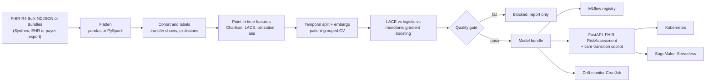

# ReadmitRisk

**FHIR-native 30-day hospital readmission risk prediction, from HL7® FHIR® R4 records to a calibrated, explained, monitored, quality-gated service.**

[](https://github.com/qasmendoza/readmit-risk/actions/workflows/ci.yml)


[](https://github.com/astral-sh/ruff)

> **All data in this repository is synthetic.** No real patient data was used. The model is decision support for prioritizing outreach, not a diagnostic tool, and it has not been validated for clinical use.

Value-based care programs use readmission risk models to decide which discharged patients get a follow-up call, an early clinic visit, or a medication review, and the CMS Hospital Readmissions Reduction Program financially penalizes hospitals with excess readmissions. ReadmitRisk implements that workflow end to end. It ingests FHIR R4 data (Bulk Data NDJSON or Bundles, contract-tested against real [Synthea](https://github.com/synthetichealth/synthea) output), builds a CMS-style cohort with point-in-time features, benchmarks machine-learning models against the validated **LACE** clinical index with rigorous statistics, and serves calibrated, explained risk scores as standard **FHIR `RiskAssessment`** resources alongside a citation-grounded care-transition copilot.

## Results

<!-- RESULTS:START -->
**Data:** synthetic FHIR R4 (readmit generator) · 6,570 index hospitalizations · 30-day readmission rate 14.6% · model `20261011.160035-294a166`

| Held-out metric (95% CI) | Selected: `logistic` | Baseline: `lace` |
|---|---|---|
| AUROC | 0.803 (0.758–0.839) | 0.752 |
| AUPRC | 0.446 (0.325–0.543) | 0.340 |
| Brier score | 0.099 (0.084–0.114) | 0.107 |
| Calibration slope | 1.05 | 0.99 |

AUROC vs. LACE: +0.051 (95% CI +0.024 to +0.078, DeLong p < 0.001). Flagging the top 10% of discharges (care-management capacity) catches **34.6%** of readmissions with PPV 52.5% (3.7× the base rate).

> Synthetic data with a known, relatively clean mechanism: these numbers demonstrate the pipeline, not clinical performance. Published readmission models typically reach C-statistics of about 0.6-0.7 on real data.

Details: [evaluation report](reports/REPORT.md) · [model card](reports/MODEL_CARD.md) · [figures](reports/figures)
<!-- RESULTS:END -->

## What this project demonstrates

| Area | Implementation | Code |
|---|---|---|
| Healthcare interoperability | FHIR R4 Bulk NDJSON and Bundle ingestion (US Core race/ethnicity, blood-pressure components, medication references); FHIR `RiskAssessment` output; verified on a real Synthea bulk export | [`fhir/`](src/readmit/fhir) |
| Clinical cohort logic | CMS-style index stays: transfer-chain merging, non-acute settings excluded, in-hospital deaths and censored follow-up removed | [`cohort.py`](src/readmit/cohort.py) |
| Feature engineering | 28 point-in-time features incl. Charlson Comorbidity Index and LACE; leakage-proofed by a property test | [`features.py`](src/readmit/features.py) |
| Statistics and hypothesis testing | Table 1 with Mann-Whitney/χ²/Fisher tests, Holm correction, SMDs; DeLong test; patient-level cluster bootstrap CIs; calibration slope/intercept, Hosmer-Lemeshow | [`analysis.py`](src/readmit/analysis.py), [`evaluation/`](src/readmit/evaluation) |
| Predictive modeling | LACE baseline vs. regularized logistic regression vs. monotonic gradient boosting (scikit-learn), patient-grouped CV, temporal validation with embargo, calibrated probabilities | [`models.py`](src/readmit/models.py) |
| Responsible AI | Subgroup fairness audit, model card, decision-curve analysis, local explanations, quality gate that blocks weak or unfair models | [`evaluation/fairness.py`](src/readmit/evaluation/fairness.py), [`reports/MODEL_CARD.md`](reports/MODEL_CARD.md) |
| MLOps | MLflow tracking and model registry (pyfunc), reproducible pinned environment, automated quality gate in CI and in the Docker build | [`tracking.py`](src/readmit/tracking.py), [`pipeline.py`](src/readmit/pipeline.py) |
| Serving | FastAPI microservice: FHIR in/out, API-key auth, size limits, Prometheus metrics, PHI-safe pseudonymized audit logs | [`serving/`](src/readmit/serving) |
| Containers and Kubernetes | Multi-stage non-root image; Kustomize overlays meeting the Pod Security "restricted" profile, HPA, PDB, network policies, drift-monitoring CronJob | [`Dockerfile`](Dockerfile), [`deploy/k8s/`](deploy/k8s) |
| Cloud ML | Same image deploys to **AWS SageMaker Serverless Inference** (BYOC `/ping` + `/invocations`), with SSE-KMS S3 uploads and teardown | [`cloud/sagemaker.py`](src/readmit/cloud/sagemaker.py) |
| Monitoring | Data and prediction drift (PSI + standardized mean difference) and label-delayed performance checks | [`monitoring/`](src/readmit/monitoring) |
| Distributed processing | PySpark FHIR flattening with column-for-column parity to pandas, enforced in CI (Databricks-ready) | [`fhir/spark_flatten.py`](src/readmit/fhir/spark_flatten.py) |
| GenAI / RAG | Care-manager copilot: retrieval over guidance documents + Claude, with citation validation, minimum-necessary context, and a deterministic fallback | [`copilot/`](src/readmit/copilot) |
| CI/CD | GitHub Actions: lint, tests + coverage, Spark parity, training with quality gate, Docker build + smoke tests (Kubernetes and SageMaker modes), manifest validation, GHCR release | [`.github/workflows/`](.github/workflows) |

## Architecture



## Quickstart

```bash
git clone https://github.com/qasmendoza/readmit-risk.git && cd readmit-risk
python -m venv .venv && source .venv/bin/activate
make install   # exact dependency versions the test suite passed with
make train     # synthetic FHIR -> cohort -> features -> models -> quality gate -> reports
make serve     # API on http://localhost:8080 (interactive docs at /docs)
```

Score a **real Synthea patient record** and get a standard FHIR resource back:

```bash
curl -s -X POST localhost:8080/v1/fhir/risk-assessment \
  -H "Content-Type: application/fhir+json" \
  --data @tests/fixtures/synthea/synthea_patient_2.json
```

Or with Docker (the build trains a demo model and fails if it doesn't pass the quality gate):

```bash
docker compose up --build        # add --profile tracking for an MLflow server on :5000
```

## API

| Method | Route | Purpose |
|---|---|---|
| `POST` | `/v1/fhir/risk-assessment` | FHIR `Bundle` in, FHIR `RiskAssessment` out (latest stay, or `?encounter_id=`) |
| `POST` | `/v1/copilot/brief` | FHIR `Bundle` in, grounded care-transition brief with resource-level citations |
| `POST` | `/v1/predict` | Score precomputed features |
| `GET` | `/v1/model` | Version, held-out metrics with CIs, thresholds, feature dictionary, gate result |
| `GET` | `/health`, `/ready`, `/metrics` | Liveness, readiness, Prometheus metrics |
| `GET`/`POST` | `/ping`, `/invocations` | Amazon SageMaker hosting contract |

Set `READMIT_API_KEY` to require an `X-API-Key` header on `/v1/*`. With `ANTHROPIC_API_KEY` set, the copilot writes briefs with Claude; without it, it returns a deterministic template brief built from the same evidence.

## Engineering decisions worth noting

Several of these came from bugs or statistical traps found while building the project.

- **Transfer chains are one hospitalization.** Synthea models an ICU stay as three back-to-back encounters (admission, ICU transfer, ward). Counted naively, every transfer becomes a "readmission" and corrupts the labels, so contiguous acute encounters are merged, as in CMS methodology.
- **Features only use what was known at discharge.** Conditions count from their `recordedDate` (a back-dated onset documented later cannot leak in), `MedicationRequest.status` is ignored because it reflects export time rather than discharge time, and the ED visit that triggered the admission is not a "prior" visit. A property test truncates real records at the discharge timestamp and asserts the features are identical.
- **Validation mirrors deployment.** Models train on earlier discharges and are tested on later ones, with a 30-day embargo so no training label depends on test-period events. Cross-validation is grouped by patient, and model selection uses CV results, never the test set.
- **Repeat patients are not independent observations.** An episode-level Table 1 reported sex and race as "significantly" associated with readmission (p < 0.001) although the data-generating process has no effect of either; with one randomly chosen stay per patient, the p-values were 0.67 and 0.087. Confidence intervals use a patient-level cluster bootstrap for the same reason.
- **ML must beat the clinical baseline to ship.** The quality gate requires a minimum AUROC and an improvement over the LACE index (with a DeLong test reported). Blocked models are never written to the model directory, and the Docker build fails if the gate fails.
- **Clinical plausibility is enforced.** Gradient boosting uses monotonic constraints, so predicted risk can never fall as prior admissions, ED visits, or comorbidity burden rise; a test checks this on the deployed model.
- **Terminology rules are tested against real data.** Charlson categories are matched on SNOMED/ICD-10 display text, with cases taken from Synthea output: "Suspected lung cancer" and "Carcinoma in situ" are not malignancy, CKD stages 1-2 are not renal disease. A regression test exists because "Hearing aids user" once matched AIDS/HIV and added 6 points.
- **One drift metric was not enough.** PSI reported only 0.08 when ED visits per stay rose 77%, and it is always 0 for binary features (all quantile bins collapse), so it could never flag a change in heart-failure prevalence. Drift is flagged when either PSI or the standardized mean difference crosses its threshold.
- **The LLM is fenced in.** The copilot receives minimum-necessary context (age bands, relative dates, no names or addresses), must cite FHIR resource ids and guidance ids, and any citation that doesn't match supplied evidence is stripped and counted in a Prometheus metric.
- **No training/serving skew.** The API computes features with the same function as training, and reads cohort and feature settings from the model bundle's metadata.

## Running on Synthea

```bash
make synthea   # downloads Synthea (Java 17+), generates a bulk FHIR export, evaluates the pipeline
```

Synthea is ideal for interoperability testing, but its 30-day readmissions are rare (about 4-6%) and are not driven by clinical risk factors. The default demo therefore uses this repository's synthetic population generator, which produces Synthea-shaped FHIR with a documented, literature-informed readmission mechanism and an unobserved frailty term (see [docs/METHODOLOGY.md](docs/METHODOLOGY.md)). The Synthea run validates ingestion end to end with the quality gate disabled.

## Documentation

- [docs/METHODOLOGY.md](docs/METHODOLOGY.md): cohort definition, features, validation design, statistics, synthetic data mechanism
- [paper/ReAdmitRisk.pdf](paper/ReAdmitRisk.pdf): paper describing the system, methods, and results
- [docs/DEPLOYMENT.md](docs/DEPLOYMENT.md): Docker, Kubernetes (kind walkthrough), AWS SageMaker, MLflow, monitoring
- [docs/SECURITY_AND_COMPLIANCE.md](docs/SECURITY_AND_COMPLIANCE.md): PHI handling, HIPAA-aligned controls, threat model, known gaps
- [reports/REPORT.md](reports/REPORT.md) and [reports/MODEL_CARD.md](reports/MODEL_CARD.md): generated by the latest training run

## Project layout

```
src/readmit/
├── fhir/              FHIR R4 parsing (pandas + PySpark), synthetic generator, RiskAssessment builder
├── cohort.py          index hospitalizations, transfer chains, exclusions, labels
├── features.py        point-in-time features, Charlson, LACE, feature registry
├── analysis.py        Table 1 with hypothesis tests
├── models.py          candidates, temporal split, grouped CV, calibration
├── evaluation/        metrics, DeLong, fairness audit, decision curves
├── explain.py         permutation importance and per-patient drivers
├── pipeline.py        orchestration and the quality gate
├── copilot/           retrieval, minimum-necessary context, guarded generation
├── monitoring/        drift (PSI + SMD) and performance monitoring
├── serving/           FastAPI app, schemas, security controls
├── cloud/             SageMaker deployment
└── cli.py             `readmit synth | run | monitor | score | serve | sagemaker`
knowledge/             care-transition guidance used by the copilot
tests/                 unit, property, contract (real Synthea fixtures), API, and parity tests
deploy/k8s/            Kustomize base + dev/prod overlays
```

## Testing

```bash
make test        # pytest with coverage
make lint        # ruff
make k8s-validate
```

The suite covers terminology rules, FHIR parsing against real Synthea bundles, cohort edge cases, leakage property tests, statistical routines (DeLong validated against scikit-learn and the bootstrap), the end-to-end pipeline and quality gate, the API (auth, limits, FHIR output, audit pseudonymization), copilot guardrails, MLflow round-trips, and PySpark parity.

## Limitations

Trained and evaluated on synthetic data only, so real-world performance is unknown. The CMS planned-readmission algorithm is not implemented, readmissions to facilities outside the data source are invisible, and a utilization outcome can encode differences in access to care. Prospective local validation, governance review, and ongoing monitoring would be required before any clinical use. See the [model card](reports/MODEL_CARD.md).

## License

MIT. HL7® and FHIR® are registered trademarks of Health Level Seven International.
