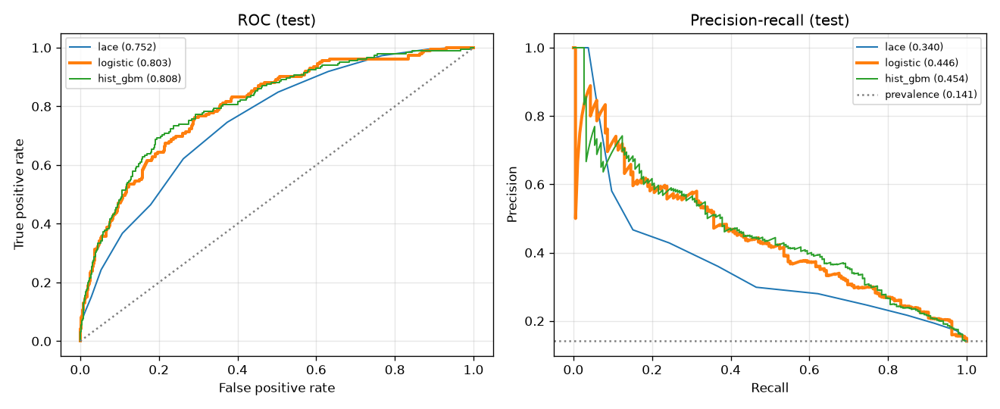
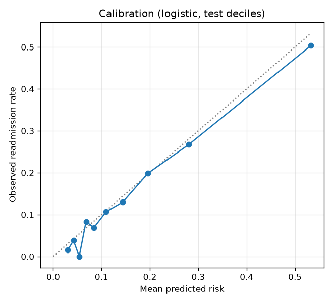
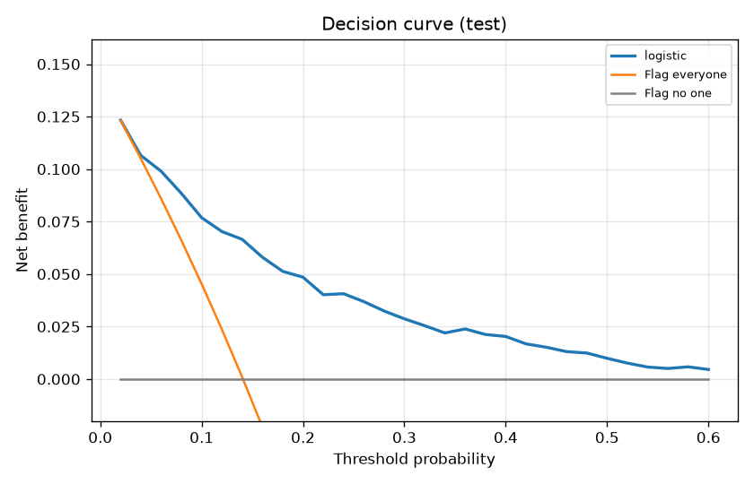
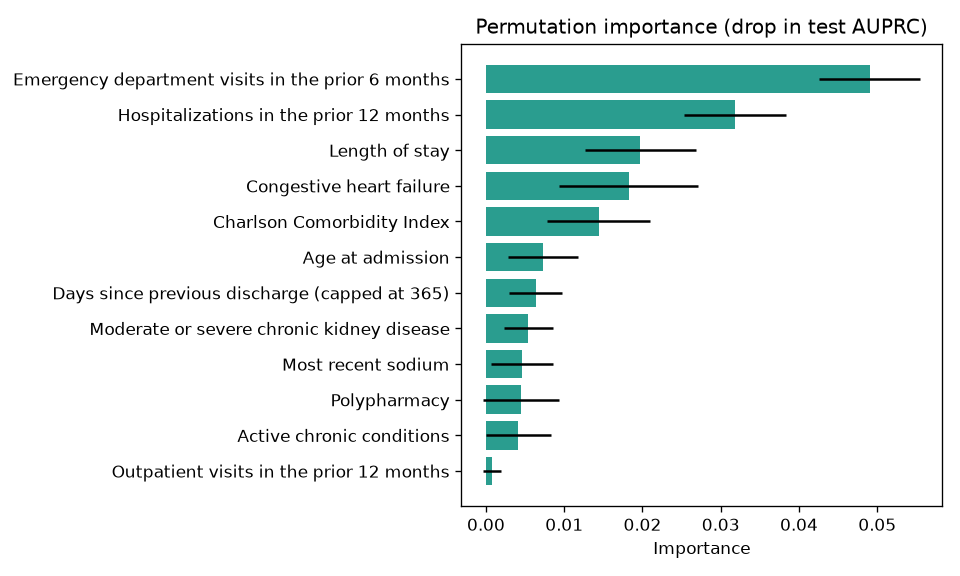

# Readmission risk model: evaluation report

Model version `20261011.211408-294a166` · data source **synthetic FHIR R4 (readmit generator)** · generated 2026-10-11T21:14:08+00:00

## 1. Cohort

| Step | n |
|---|---|
| Inpatient encounters | 8,166 |
| Acute inpatient encounters (non-acute settings removed) | 7,570 |
| Hospitalizations after merging transfer chains | 6,836 |
| Age >= 18 at admission | 6,836 |
| Alive at discharge | 6,582 |
| Full 30-day follow-up observable | 6,570 |
| Index hospitalizations (readmitted within 30 days) | 6,570 (959) |

30-day readmission rate: **14.6%**.

## 2. Cohort characteristics (Table 1)

One randomly selected index hospitalization per patient, because stays from the same patient are not independent and pooling them inflates significance. Readmitted n = 150; not readmitted n = 2,053. Continuous variables: median [IQR]; binary: n (%). p-values are Holm-adjusted; |SMD| > 0.1 indicates meaningful imbalance.

| Variable | Readmitted | Not readmitted | Test | p (Holm) | SMD |
|---|---|---|---|---|---|
| Age at admission | 84.0 [76.1–94.2] | 76.2 [62.3–86.2] | Mann-Whitney U | < 0.001 | +0.59 |
| Male sex | 70 (46.7%) | 1,002 (48.8%) | chi-square | 1.000 | -0.04 |
| Length of stay | 3.9 [2.6–5.8] | 3.0 [2.1–4.5] | Mann-Whitney U | < 0.001 | +0.35 |
| Admitted through the emergency department | 109 (72.7%) | 1,281 (62.4%) | chi-square | 0.106 | +0.22 |
| Hospitalizations in the prior 12 months | 0.0 [0.0–2.0] | 0.0 [0.0–0.0] | Mann-Whitney U | < 0.001 | +0.69 |
| Emergency department visits in the prior 6 months | 0.0 [0.0–1.0] | 0.0 [0.0–0.0] | Mann-Whitney U | < 0.001 | +0.63 |
| Charlson Comorbidity Index | 2.0 [1.0–4.0] | 1.0 [0.0–2.0] | Mann-Whitney U | < 0.001 | +0.84 |
| Congestive heart failure | 46 (30.7%) | 228 (11.1%) | chi-square | < 0.001 | +0.50 |
| Chronic pulmonary disease | 31 (20.7%) | 202 (9.8%) | chi-square | < 0.001 | +0.30 |
| Moderate or severe chronic kidney disease | 54 (36.0%) | 228 (11.1%) | chi-square | < 0.001 | +0.61 |
| Diabetes with complications | 26 (17.3%) | 167 (8.1%) | chi-square | 0.002 | +0.28 |
| Dementia | 14 (9.3%) | 94 (4.6%) | chi-square | 0.106 | +0.19 |
| Cancer (any malignancy, including metastatic) | 12 (8.0%) | 94 (4.6%) | chi-square | 0.435 | +0.14 |
| Documented social needs | 0.0 [0.0–0.0] | 0.0 [0.0–0.0] | Mann-Whitney U | 1.000 | -0.05 |
| Polypharmacy | 82 (54.7%) | 560 (27.3%) | chi-square | < 0.001 | +0.58 |
| Most recent eGFR | 72.5 [46.8–85.6] | 83.2 [72.6–91.9] | Mann-Whitney U | < 0.001 | -0.59 |
| Most recent sodium | 138.1 [135.0–141.1] | 139.2 [136.7–141.7] | Mann-Whitney U | 0.011 | -0.28 |
| LACE index | 9.0 [6.2–11.0] | 6.0 [4.0–7.0] | Mann-Whitney U | < 0.001 | +0.97 |
| Race (max level SMD) | 6 levels |  | chi-square | 0.435 | +0.16 |
| Ethnicity (max level SMD) | 2 levels |  | chi-square | 1.000 | +0.04 |

## 3. Model development

Temporal split at 2023-12-22: 5,205 training and 1,314 test hospitalizations; 51 stays in the 30-day embargo before the cutoff were excluded so no training label depends on test-period events. Hyperparameters were tuned with 5-fold patient-grouped cross-validation; final models use grouped cross-validated sigmoid calibration.

| Model | CV AUPRC | CV AUROC | CV Brier | Selected hyperparameters |
|---|---|---|---|---|
| lace | 0.385 ± 0.040 | 0.767 ± 0.016 | 0.1070 | – |
| **logistic** | 0.478 ± 0.055 | 0.807 ± 0.018 | 0.0992 | C=0.03 |
| hist_gbm | 0.462 ± 0.048 | 0.802 ± 0.017 | 0.1009 | learning_rate=0.05, max_leaf_nodes=31 |

Selected **logistic** by cross-validated average_precision.

## 4. Held-out performance (most recent discharges)

| Model | AUROC | AUPRC | Brier | Cal. slope | Cal. intercept | ECE |
|---|---|---|---|---|---|---|
| lace | 0.752 | 0.340 | 0.1073 | 0.99 | -0.03 | 0.023 |
| **logistic** | 0.803 | 0.446 | 0.0988 | 1.05 | -0.13 | 0.017 |
| hist_gbm | 0.808 | 0.454 | 0.0980 | 1.07 | -0.15 | 0.021 |

Selected model with 95% patient-level cluster-bootstrap CIs (1,000 resamples): AUROC 0.803 (0.758–0.839), AUPRC 0.446 (0.325–0.543), Brier 0.0988 (0.0842–0.1136). Test prevalence 14.1%.

Paired DeLong tests (selected model minus comparator, same test hospitalizations):

| Comparator | ΔAUROC | 95% CI | p |
|---|---|---|---|
| lace | +0.051 | +0.024 to +0.078 | < 0.001 |
| hist_gbm | -0.005 | -0.016 to +0.006 | 0.357 |

## 5. Calibration

Calibration slope 1.05 (ideal 1), calibration-in-the-large -0.13 (ideal 0), ECE 0.017. Hosmer–Lemeshow χ² = 10.3, p = 0.247 (sensitive to sample size; shown for completeness, the slope and intercept are the primary calibration measures).

## 6. Decision analysis

Threshold set on training-period scores to flag the top 10% (risk ≥ 0.361), then applied unchanged to the test period:

| Flag rate | Sensitivity | Specificity | PPV | Patients per readmission found | Lift |
|---|---|---|---|---|---|
| 9.3% | 34.6% | 94.9% | 52.5% | 1.9 | 3.73× |

Decision curve: the model offers higher net benefit than treating everyone or no one for threshold probabilities between 0.02 and 0.60.

## 7. Fairness audit

Race and ethnicity are not model inputs; they are used only for this audit. Groups smaller than 50 are not compared.

| Attribute | Group | n | AUROC | O/E | Flag rate | Sensitivity | Note |
|---|---|---|---|---|---|---|---|
| sex | female | 689 | 0.807 | 0.89 | 11.0% | 38.2% |  |
| sex | male | 625 | 0.797 | 0.95 | 7.4% | 30.1% |  |
| race | American Indian or Alaska Native | 29 | – | – | – | – | n < 50: insufficient for comparison |
| race | Asian | 84 | 0.611 | 1.00 | 4.8% | 9.1% |  |
| race | Black or African American | 174 | 0.744 | 0.95 | 2.3% | 5.6% |  |
| race | Native Hawaiian or Other Pacific Islander | 5 | – | – | – | – | n < 50: insufficient for comparison |
| race | Other | 196 | 0.799 | 0.54 | 12.2% | 50.0% |  |
| race | White | 826 | 0.813 | 0.95 | 9.3% | 33.6% |  |
| ethnicity | Hispanic or Latino | 244 | 0.805 | 0.77 | 7.4% | 34.6% |  |
| ethnicity | Not Hispanic or Latino | 1,070 | 0.801 | 0.94 | 9.7% | 34.6% |  |
| age_band | 18-44 | 49 | – | – | – | – | n < 50: insufficient for comparison |
| age_band | 45-64 | 158 | 0.805 | 1.08 | 0.0% | 0.0% |  |
| age_band | 65-74 | 143 | 0.664 | 0.50 | 0.7% | 0.0% |  |
| age_band | 75-84 | 344 | 0.762 | 0.91 | 5.5% | 17.1% |  |
| age_band | 85+ | 620 | 0.784 | 0.95 | 16.5% | 45.2% |  |

- **sex**: AUROC gap 0.010, sensitivity gap 8.1 pp, flag-rate ratio 0.67, equal-opportunity χ² p = 0.318

- **race**: AUROC gap 0.202, sensitivity gap 44.4 pp, flag-rate ratio 0.19, equal-opportunity χ² p = 0.011

- **ethnicity**: AUROC gap 0.004, sensitivity gap 0.0 pp, flag-rate ratio 0.76, equal-opportunity χ² p = 1.000

- **age_band**: AUROC gap 0.141, sensitivity gap 45.2 pp, flag-rate ratio 0.00

## 8. Explainability (permutation importance on the test set)

| Feature | Mean drop in AUPRC | SD |
|---|---|---|
| Emergency department visits in the prior 6 months | 0.0490 | 0.0064 |
| Hospitalizations in the prior 12 months | 0.0319 | 0.0065 |
| Length of stay | 0.0197 | 0.0071 |
| Congestive heart failure | 0.0182 | 0.0089 |
| Charlson Comorbidity Index | 0.0144 | 0.0066 |
| Age at admission | 0.0073 | 0.0044 |
| Days since previous discharge (capped at 365) | 0.0063 | 0.0034 |
| Moderate or severe chronic kidney disease | 0.0054 | 0.0031 |
| Most recent sodium | 0.0046 | 0.0040 |
| Polypharmacy | 0.0045 | 0.0048 |
| Active chronic conditions | 0.0042 | 0.0042 |
| Outpatient visits in the prior 12 months | 0.0008 | 0.0011 |

## 9. Quality gate

| Check | Result | Detail |
|---|---|---|
| minimum_auroc | ✅ pass | test AUROC 0.803 (required >= 0.65) |
| beats_baseline | ✅ pass | AUROC +0.051 vs lace (DeLong p = 0.000206) |

Overall: **PASSED** (enforced).

## 10. Copilot retrieval evaluation

Guidance retrieval hit rate@3: 100%, MRR 1.00 over 10 labelled queries.

## Figures

## Limitations

Synthetic data; CMS planned-readmission logic not applied; readmissions to facilities outside the data source are invisible; a utilization label can encode differences in access to care. See the model card for intended use.
